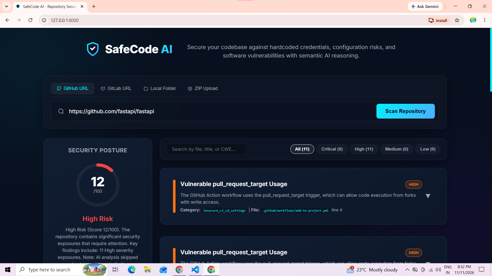

# SafeCode AI 🔐

**AI-Powered Repository Security Analyzer**

SafeCode AI is a repository security analysis tool that combines static security scanning with Groq-powered AI analysis to help identify potential vulnerabilities in source code.

## 🚀 Features

- **Multi-source scanning:** Analyze public GitHub/GitLab repositories, local directories, and ZIP uploads.
- **AI-powered analysis:** Uses Groq LLM to identify potential security vulnerabilities.
- **Code chunking:** Processes source code in manageable chunks for AI analysis.
- **Security findings:** Displays vulnerability descriptions, severity, confidence, and suggested fixes.
- **Code comparison:** View vulnerable and remediated code side by side.
- **Patch generation:** Generate suggested code patches for identified vulnerabilities.
- **Security reports:** Export reports in supported formats such as JSON, CSV, Markdown, HTML, and SARIF.
- **Web dashboard:** Interact with the scanner through a browser-based interface.

## 🛠️ Technologies Used

| Technology | Purpose |
|---|---|
| Python | Backend development |
| FastAPI | REST API |
| Groq API | AI-powered code analysis |
| JavaScript | Frontend functionality |
| HTML & CSS | User interface |
| Docker | Containerized deployment |

## 🏗️ Project Architecture

1. **Frontend:** Provides the interface for submitting repositories and viewing scan results.
2. **FastAPI backend:** Handles API requests and coordinates scanning.
3. **Repository processing:** Loads and prepares source code for analysis.
4. **Security scanners:** Performs static security checks.
5. **Groq AI scanner:** Analyzes code chunks for potential vulnerabilities.
6. **Report generation:** Presents findings and suggested remediation.

## ⚙️ Installation and Setup

### 1. Clone the repository

```bash
git clone https://github.com/umme-haney19/SafeCode-AI.git
cd SafeCode-AI
```

### 2. Create a virtual environment

```bash
python -m venv venv
```

Activate it on Windows:

```powershell
.\venv\Scripts\Activate.ps1
```

### 3. Install dependencies

```bash
pip install -r requirements.txt
```

### 4. Configure the API key

Copy `.env.example` to `.env`:

```powershell
Copy-Item .env.example .env
```

Add your Groq API key to `.env`:

```env
GROQ_API_KEY=your_groq_api_key
```

Never upload your actual `.env` file or API key to GitHub.

### 5. Run the application

On Windows PowerShell:

```powershell
.\start.ps1
```

Open the application in your browser:

http://127.0.0.1:8000

## 🖥️ Dashboard Preview



## 📡 API Endpoints

| Method | Endpoint | Purpose |
|---|---|---|
| POST | `/repository/analyze` | Start a repository security scan |
| POST | `/repository/upload` | Upload a ZIP repository |
| POST | `/repository/cancel/{scan_id}` | Cancel a scan |
| GET | `/scan/status/{scan_id}` | Check scan progress |
| GET | `/repository/report` | Download a scan report |
| GET | `/health` | Check API health |

*Check the running application's API documentation for the exact request parameters and response formats.*

## 🔮 Future Improvements

- Improve vulnerability detection accuracy.
- Add more security scanning rules.
- Enhance the dashboard and visualization.
- Add automated security testing.
- Improve scan performance for large repositories.

## 📄 License and Attribution

SafeCode AI is an independently customized repository security analysis tool developed by **Umme Haney Sallauddin**.

The project includes custom UI design, branding improvements, and security-scanning enhancements.

This project is distributed under the **Apache License 2.0**. See the [LICENSE](LICENSE) file for complete license terms.

## 👩‍💻 Developer

**Umme Haney Sallauddin**

GitHub: [umme-haney19](https://github.com/umme-haney19)

*SafeCode AI — Making repository security analysis easier with AI.*